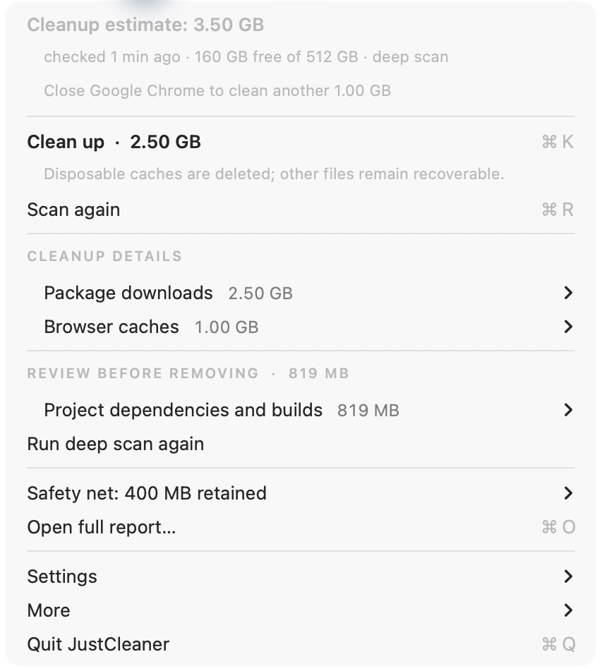
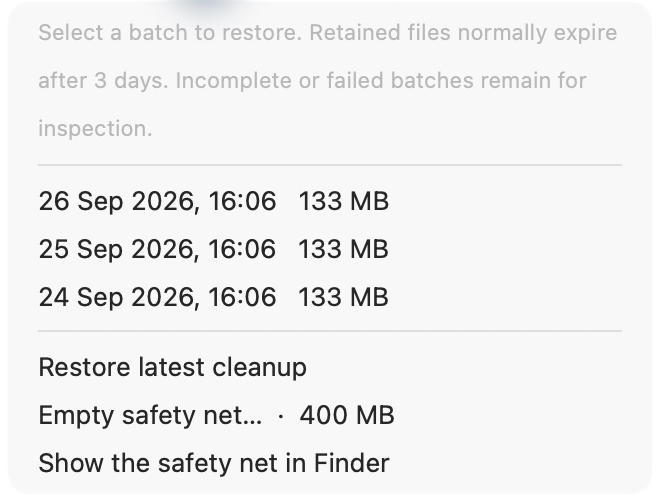
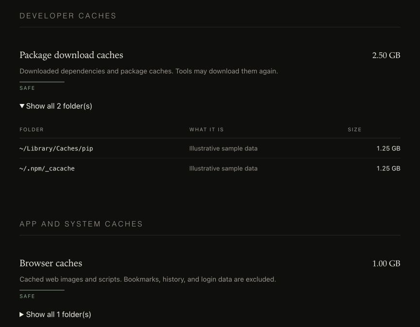

# JustCleaner


**Find removable caches. Clean what is ready. Restore retained files.**

A local macOS menu-bar utility for coding-tool caches, package downloads,
and app leftovers. **macOS 11+ · Apple silicon + Intel · No account**

## Download packages

Choose the package for your computer from [GitHub Releases](https://github.com/jing1ei/justcleaner/releases/latest).

| Computer | Package |
| --- | --- |
| Mac with Apple silicon | `JustCleaner-1.1.1-macOS-arm64.dmg` |
| Mac with Intel | `JustCleaner-1.1.1-macOS-x64.dmg` |

On macOS, open the DMG and drag the app to Applications.
Each release includes one source ZIP and `SHA256SUMS.txt`.

## Install

From the source folder:

```bash
./build.sh --install
```

Requires Apple's Command Line Tools (`xcode-select --install`). The build
installs JustCleaner in `/Applications`, falling back to `~/Applications`, and opens
it. **Click the sparkle icon in the menu bar. There is no Dock window.**
The menu automatically follows macOS Light, Dark, or Auto appearance.

Have the packaged app? Open the DMG for your Mac, drag JustCleaner.app to Applications, then run
**Install JustCleaner.command**. The package needs no compiler. This local build is
ad-hoc signed, not notarized; use your Mac's normal approval flow if prompted.

## Use

| Step | Action | Result |
| --- | --- | --- |
| **Scan** | Open the menu; choose **Scan again** to refresh. | Estimated removable size, with running-app exclusions. |
| **Inspect** | Open a category or **Open full report…**. | Explanations and folder paths. Click a menu path to reveal it in Finder. |
| **Clean** | Choose **Clean up**. | Eligible files move to the safety net. Safe caches may then be erased. |
| **Restore** | Open **Safety net** and choose a dated batch. | Retained files return without overwriting existing files. |

**Prefer an undo window?** Turn off **Settings → Delete disposable caches
immediately** before cleaning. Retained files normally stay for 3 days; change
that duration in Settings. Moving files to the safety net does not free space
until they are erased.

### Cleanup at a glance



### Recover retained files

Older batches remain under **Older cleanups**. **Empty safety net…** asks before
permanently removing retained files.



### Understand every folder

The offline report has section links and expandable complete folder lists.



*Screenshots show JustCleaner with illustrative sample data.*

## Safety and recovery

- Music, recognized audio projects/plugins, credentials, and protected paths
  are excluded. Personal folders are excluded from automatic cleanup;
  recognized project build folders there can be reviewed when enabled.
- Projects, assistant runtimes, models, and chat history require a separate
  decision. Running-app checks are a precaution, not proof a folder is unused.
- Immediately erased files, Trash, and Homebrew cleanup cannot be undone.
  Homebrew uses its own command outside the safety net.
- Interrupted, legacy, failed, and unlisted recovery data are kept for manual
  inspection. Cleanup and restore refuse cross-volume moves.
- Space values are estimates. APFS snapshots, shared blocks, hard links, and
  open files can delay reclaimed space. JustCleaner is not a backup system.

| If… | Do this |
| --- | --- |
| Caches are in use | Close the named app and scan again. |
| Restore needs attention | Choose **Show Retained Files**. Close the owning app and move any replacement folder somewhere safe before retrying. |
| Settings are damaged | **Settings → Reset settings…** saves the old file and restores defaults. Recovery data stays in place. |
| Folders are missing | Check project/personal-folder settings. Full Disk Access is optional and never bypasses safety rules. |
| An action fails | Read the menu feedback and **More → Open activity log…**. |

Use **Run deep scan…** to include projects, models, chat history, and Trash.
Export an installable copy through **More → Export app for another Mac…**.

To start at login, enable it in Settings. To uninstall, disable start at login,
quit JustCleaner, and move the app to Trash. Keep recovery files until no longer needed.

## Build and release

```bash
./build.sh                       # build/JustCleaner.app (universal when the Mac can build both slices)
./build.sh --arch=arm64          # Apple silicon only; --arch=x86_64 for Intel
./Tests/run.sh                   # isolated regression tests
./release.sh                     # verified source ZIP, arm64/x64 DMGs, SHA256SUMS.txt in dist/
```

`build.sh` selects the newest macOS SDK the installed compiler supports, so a
Command Line Tools release that lags the latest macOS SDK no longer breaks the
build; set `SDKROOT` to override.

`./sync.sh` updates the local installer/source files in `site/`; it does not
publish them. `Sources/App/` contains the interface and CLI; `Sources/Core/`
contains scanning, safety, cleanup, persistence, and reports.

```bash
./build/JustCleaner.app/Contents/MacOS/JustCleaner scan
./build/JustCleaner.app/Contents/MacOS/JustCleaner clean --dry-run
./build/JustCleaner.app/Contents/MacOS/JustCleaner report --open
./build/JustCleaner.app/Contents/MacOS/JustCleaner help
```

Noninteractive cleaning requires `--yes`. No shell alias is installed.

State stays in `~/.justcleaner/`: settings, last scan, activity log, reports,
and quarantine. Screenshots and their
[provenance](docs/screenshots/README.md) ship with the source.

## GitHub automation

Every push to main and every pull request runs the tests, builds the universal macOS app, and
saves the verified ZIPs and checksums as Actions artifacts. Pull requests and
ordinary branch pushes never publish.

A **release is built automatically** when you push to `main` or push a version
tag. The version comes from `JustCleanerVersion.string` in
`Sources/Core/Environment.swift`; to ship a new release, bump it and tag:

```bash
# edit Sources/Core/Environment.swift: static let string = "1.0.1"
git push origin HEAD
git tag v1.0.1
git push origin v1.0.1
```

A tag must match the version. After checks pass, Actions publishes the app ZIP,
source ZIP, and `SHA256SUMS.txt` as a GitHub Release. Releases are immutable:
a published tag is never moved or overwritten, and re-running the same commit
is a no-op, so always use a new version. Publication is all-or-nothing — every
asset is downloaded and checksum-verified before the draft release goes public.

Enable GitHub Actions on the repository. No personal token is needed: only the
publish job uses GitHub's built-in token with `contents: write`; repository or
organization policy must allow that permission. These builds are ad-hoc signed;
the workflow does not perform Apple notarization.

Check the workflow and publisher locally:

```bash
python3 Tests/workflow.py
JC_VERSION=1.1.0 python3 .github/scripts/test_release.py
```

See [release automation](.github/RELEASES.md) for the exact packages,
checksums, and failure behavior.

## Distribution

The release script verifies both architectures and the code signature. For
public distribution, sign with your Developer ID, notarize, and staple the app
before packaging. A locally signed build does not provide notarization or
stable permission grants across rebuilds.

Validation here covers local regression tests and compilation for both
architectures. Actual macOS 11 execution, login/logout, TCC denial, and
power-loss behavior need testing in a disposable Mac or VM before broad rollout.

### Editor and assistant cleanup

The editor-cache category recognizes Codex, Claude Code, Cursor, VS Code,
Windsurf, Trae and Kiro cache/log folders, including small caches from 128 KiB.
Generic app and dot-folder rules cover additional tools. Recognized running
apps are skipped; Node processes conservatively block assistant cache removal
because a CLI assistant may run inside Node. Close the owning tool first.

Deep scans list individual files in `~/.codex/archived_sessions` for explicit
review. Archived conversations are **not deleted sessions**: removing these
files loses resumable history. Session databases, indexes, editor workspace
storage, backups and worktrees are protected. JustCleaner does not compact
SQLite databases or infer which records represent deleted chats; use the IDE's
own deletion controls for those. Custom assistant data roots are not explicitly
supported by the named rules. No system-wide `/tmp` sweep is performed.
